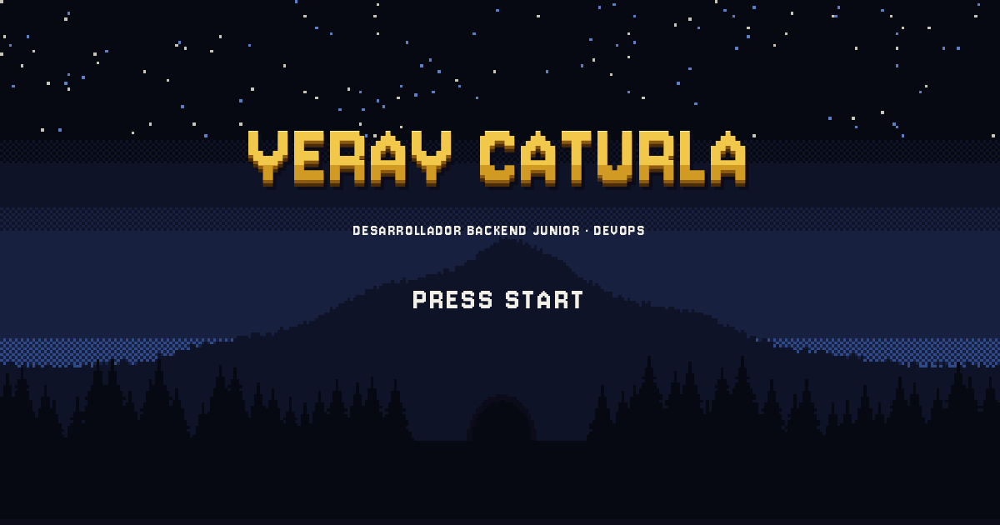
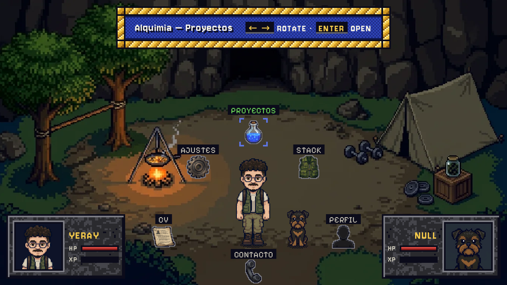

# Yeray Caturla — a 16-bit portfolio

[](https://github.com/yeraox/dev-portfolio/actions/workflows/deploy.yml)

The portfolio of Yeray Caturla, junior backend developer, built as a small original 16-bit
action-RPG: a title screen, an intro out of a cave, and a camp where a ring menu opens his CV,
section by section. The CV is one step away from the first screen, for anyone who would rather
not play.

**Live:** [yeraycaturla.pages.dev](https://yeraycaturla.pages.dev)





## What's inside

- **Title → intro → camp.** PRESS START plays a short scripted walk out of the cave (skippable at
  any moment); returning visitors land straight in the camp.
- **A ring menu** around Yeray: Projects, Stack, Profile, About me, Contact, the CV and Settings.
  Every slot shows its real name; each section opens a window in the style of 16-bit RPGs.
- **The CV is a PDF**, in Spanish or English, one question away from the title screen and from
  the ring.
- **Spanish and English**, chosen from the browser's language and switchable in Settings.
- **For every visitor:** keyboard only, mouse or touch; screen-reader semantics on the ring and
  the windows; "animations off" in Settings (or from the system's reduced-motion preference); the
  browser's find-in-page reaches every section.
- **Privacy:** no cookies. Visits are counted anonymously with Cloudflare Web Analytics; the
  browser only keeps the visitor's language, settings and progress.

## Highlights

| | |
|---|---|
| No game engine | React for the interface, a `<canvas>` for the scene, one `requestAnimationFrame` loop |
| Pixel-perfect | A 640×360 scene scaled by whole screen pixels; motion in whole frames; no blur, no gradients |
| Accessible | WCAG 2.2 AA contrast, tested for every text colour; native modal dialogs; ARIA menu and tabs |
| Fast | 94 KB of JavaScript (gzip); Lighthouse mobile 99 · 100 · 100 · 100; 60 fps even with a 4× slower CPU |
| Tested | 204 unit tests (Vitest) and four browser walkthroughs (Playwright) that play the site with keyboard only and touch only |
| Shipped by CI | Every push to `main` runs lint, unit tests and the typed build on GitHub Actions; only a green build is published |

## Tech stack

- **React 19 + TypeScript** (strict) on **Vite**.
- **CSS Modules** and one tokens file: a 32-colour palette, with a test that keeps CSS and code in
  sync. No CSS framework, UI kit or animation library.
- **Canvas 2D** for the scenes and the characters.
- **Vitest** for the logic, **Playwright** for screenshots and walkthroughs, **oxlint**.
- **Node scripts + ffmpeg** for the asset pipelines (characters, icons, media, share image).
- **GitHub Actions + Cloudflare Pages** (Wrangler) to test and publish every change.

## How it works

- **Content is data.** All the copy lives in two typed dictionaries (`src/content/es.ts`,
  `en.ts`): a missing translation is a compile error. Nothing is invented: no skill levels, no
  percentages.
- **State machines.** The screens (title → transition → intro → camp, and back) and the camp
  (ring ↔ window) are pure reducers with unit tests.
- **The art is generated from references, never repainted.** Yeray's character, icon and
  background images are rebuilt on their native pixel grid by scripts. Walk cycles stamp the same
  head on every frame, and idle actions lay only what moves over the still drawing. Quality
  checks fail the build of an asset when a pixel strays. See [`docs/sprites.md`](docs/sprites.md).
- **One page.** The game is a single page; its `<head>` tags and a no-JavaScript note (with the
  CV links) are generated at build time from the same content.
- **Windows load on demand** (`React.lazy`), and the camp downloads while the title is on screen.
- **A safety net:** if a device can't hold 60 fps, the loop steps down to a steady 30.

## How it was built

Built with [Claude Code](https://claude.com/claude-code) in eleven phases. Yeray set the
direction, made every decision, provided the art references and reviewed each phase (screenshots
on phone, tablet and desktop, performance numbers) before approving it. Claude Code planned and
wrote the code, following the rules in [`CLAUDE.md`](CLAUDE.md) and the skills in
[`.agents/skills/`](.agents/skills/): `impeccable` (design system, audits, polish),
`emil-design-eng` (interaction feel), `vercel-react-best-practices` and `modern-web-guidance`
(final review). It is also how Yeray learnt TypeScript.

The story, phase by phase: [`docs/proceso.md`](docs/proceso.md).

| Document | What it holds |
|---|---|
| [`PRODUCT.md`](PRODUCT.md) | Who the site is for and what it must achieve |
| [`DESIGN.md`](DESIGN.md) | The visual system: palette, type, windows, ring, motion |
| [`CONTENT.md`](CONTENT.md) | Every text on the site (Spanish source) |
| [`CLAUDE.md`](CLAUDE.md) | The rules the project is built by |
| [`docs/proceso.md`](docs/proceso.md) | How it was built, and where it stands |
| [`docs/sprites.md`](docs/sprites.md) | How the characters, icons and backgrounds are made |

## Run it locally

Requires Node.js 20.19 or newer.

```bash
npm install
npm run dev          # http://localhost:5173
npm test             # unit tests
npm run build        # typecheck + production build in dist/
npx vite preview     # serve the build on http://localhost:4173
```

The browser walkthroughs run against the build (they need Playwright's Chromium:
`npx playwright install chromium`):

```bash
npm run check:camp -- http://localhost:4173/
npm run check:windows -- http://localhost:4173/
npm run check:title -- http://localhost:4173/
npm run check:intro -- http://localhost:4173/
npm run fps -- http://localhost:4173/
```

The asset generators (`npm run characters`, `icons`, `scenes`, `cv`) read Yeray's private
`references/` folder, which is not in the repository. Their output is committed, so the site
builds and runs without it.

## Deploying

[`.github/workflows/deploy.yml`](.github/workflows/deploy.yml) runs on every pull request (lint,
unit tests, build) and, on every push to `main`, publishes `dist/` to Cloudflare Pages when all of
them pass. It needs, in the repository's Actions settings, the secrets `CLOUDFLARE_API_TOKEN`
(permission "Cloudflare Pages: Edit") and `CLOUDFLARE_ACCOUNT_ID`, and the variable
`CF_PAGES_PROJECT`. The build's `SITE_URL` (canonical link, share image, sitemap) is
`https://<CF_PAGES_PROJECT>.pages.dev`, or the variable `SITE_URL` when the site has its own
domain.

[`public/_headers`](public/_headers) sets the security headers (a Content-Security-Policy that
allows only the site's own files and Cloudflare Web Analytics) and a long cache for the hashed
build files. Web Analytics is turned on in the Pages project's dashboard.

## Project structure

```
src/
  game/        pure logic with tests: screens, camp state, ring maths, stage layout, scripts
  engine/      game loop, input, motion preference, screen hooks, character drawing
  scenes/      title, camp and cave intro
  components/  ring menu, HUD, windows, dialogs, banner
  windows/     one window per section, loaded on demand
  content/     the typed Spanish and English texts
  styles/      palette, tokens, contrast pairs
  site/        the page's head and no-JavaScript note, made at build time
  assets/      generated sprites, icons, scenes and media
scripts/       asset generators and browser checks
.github/       the deploy workflow
docs/          how it was built; how the art is made
```

## Credits

- **Art:** Yeray Caturla's own references, created with AI image tools; the scripts cut and
  compose them, and nothing is redrawn. Original work in the 16-bit RPG genre: nothing is taken
  from any existing game.
- **Fonts:** [Jersey 10](https://fonts.google.com/specimen/Jersey+10) and
  [Pixelify Sans](https://fonts.google.com/specimen/Pixelify+Sans), SIL Open Font License 1.1,
  self-hosted with [Fontsource](https://fontsource.org).
- **Technology logos** in the Stack window: [Simple Icons](https://simpleicons.org) (CC0),
  reduced to 16×16 pixels.

## License

The source code is under the [MIT License](LICENSE). Yeray's art (characters, icons, backgrounds),
the texts and the CV are © Yeray Caturla, all rights reserved.

## Contact

[LinkedIn](https://www.linkedin.com/in/yeraycaturla) · [GitHub](https://github.com/yeraox) ·
yeraoxcaturlax@gmail.com
